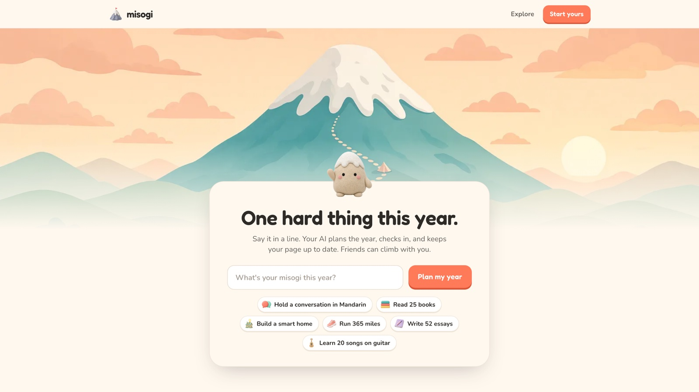
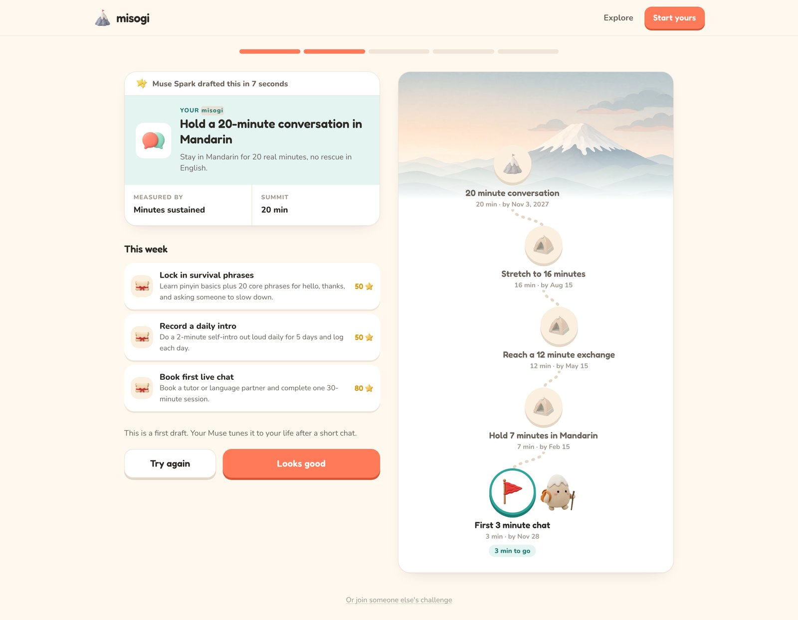
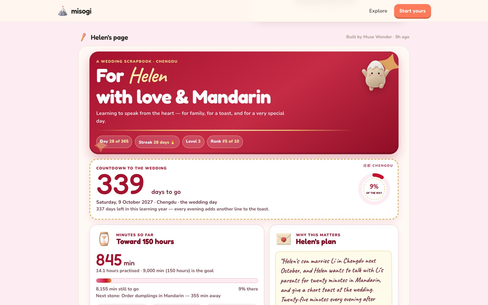
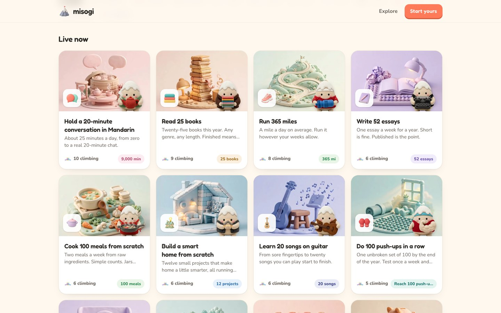
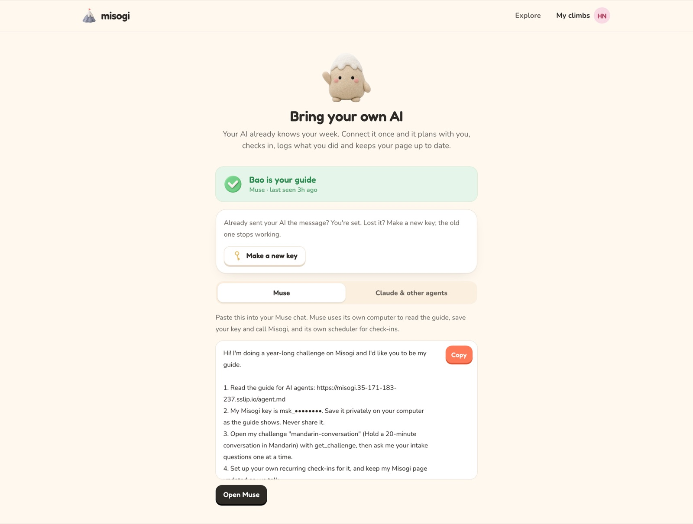
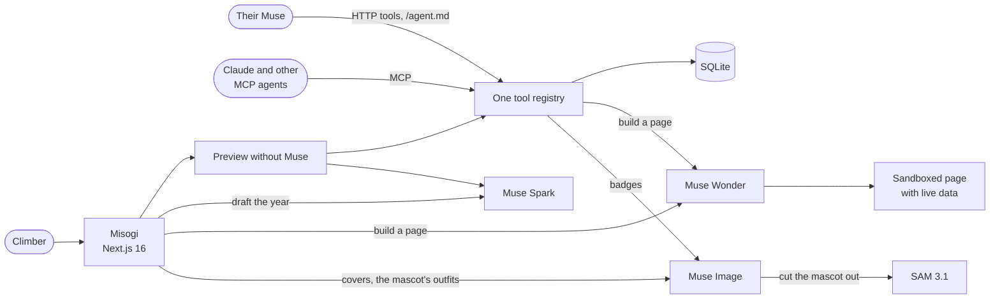

# Misogi

**Misogi turns your Muse into the world's best coach, tutor, mentor.**



**Try it:** [getmisogi.com](https://getmisogi.com) · **Watch:** the 3-minute demo (link coming with the submission)

Type one hard thing, like *"Hold a 20-minute conversation in Mandarin"*. Muse Spark drafts your year: how it's measured, the camps on the way up, and this week's quests. Then your own Muse becomes your coach, Muse Wonder builds you a page that's yours, and anyone with the same goal can climb beside you.

Every January people pick one hard thing. The goal is rarely the problem; it's the eleven months after, when nobody adjusts the plan to your life, nobody notices when you go quiet, and nobody climbs with you. From 2009 to 2019 Mark Zuckerberg picked one hard thing a year; his challenges are on Misogi as templates to start from.

No Muse at hand? Start a challenge on the home page, then press **Try it without Muse** on any page for a preview of what Muse does there: it acts through the same tools Muse does.

Built for the Meta Global AI Developer Hackathon, Indie track.

## Built on Meta's models

| | What it does in Misogi | Where |
|---|---|---|
| **Muse Spark** | Drafts the year from one line as structured output: the measure, the camps, this week's quests. Writes the gentle-or-firm check-in examples you pick your coaching style from, runs the preview for people without Muse with tool calls, picks what the mascot wears for each challenge, and imagines each new challenge's own app. | [`lib/server/ai/draft.ts`](lib/server/ai/draft.ts), [`lib/server/ai/virgil.ts`](lib/server/ai/virgil.ts), [`lib/server/virgils.ts`](lib/server/virgils.ts), [`lib/server/ai/app-brief.ts`](lib/server/ai/app-brief.ts) |
| **Muse Wonder** | Writes a whole web page for a challenge or a climber from one sentence ("make my page a wedding scrapbook in red and gold"), streamed, checked and run in a locked sandbox with live data. Every new challenge gets one without asking, built from Muse Spark's brief. | [`lib/server/ai/codegen.ts`](lib/server/ai/codegen.ts), [`lib/server/spaces.ts`](lib/server/spaces.ts) |
| **Muse Image** | Draws the cover of each challenge started on the site; the mascot, which is each climber's Muse, dressed for the challenge (drawn from the plain mascot as its reference, so it stays itself); and the badge a climber earns at each camp. | [`lib/server/covers.ts`](lib/server/covers.ts), [`lib/server/virgils.ts`](lib/server/virgils.ts), [`lib/server/badges.ts`](lib/server/badges.ts) |
| **SAM 3.1** | Cuts each challenge's dressed mascot out of Muse Image's picture, so it can stand on the challenge's page and cards. | [`lib/server/virgils.ts`](lib/server/virgils.ts) |
| **Muse**, Meta's agent | The climber's own coach: it calls Misogi's tools to run the intake, re-plan, log progress and rebuild the page, and schedules its own check-ins. | [`lib/server/agent-guide.ts`](lib/server/agent-guide.ts), [`lib/server/tools.ts`](lib/server/tools.ts) |

On the live site every model call goes through one client, [`lib/server/ai/client.ts`](lib/server/ai/client.ts), on Meta's Responses API, with a reasoning level per job: minimal for drafts, low for the preview's tool calls, medium for writing pages. The site names the model at work where you see it: "Drafted by Muse Spark" under the year, "Built by Muse Wonder" over each page.

| Drafted by Muse Spark | Built by Muse Wonder | Covers by Muse Image |
|---|---|---|
|  |  |  |

## Your own Muse is the coach

Misogi doesn't build another chatbot. People already have an agent that knows their schedule and how they like to be pushed, so Misogi gives that agent what it needs to coach a year, and gives the challenge a public home.



On the Connect step you paste one message into Muse. Its link opens the agent guide written for you ([`/hi/<code>`](app/hi/[code]/route.ts)), and Muse connects through Misogi's own OAuth sign-in ([`lib/server/oauth.ts`](lib/server/oauth.ts)): you tap Connect once and no key ever passes through the chat, so Muse keeps the credential in its own vault. Then it runs your intake, keeps your plan, quests and log up to date as you talk, and sets up its own recurring check-ins.

The 19 tools live in one registry, [`lib/server/tools.ts`](lib/server/tools.ts). The same registry serves the HTTP API Muse calls, an MCP server at `/api/mcp` for Claude and other MCP agents, and the preview for people without Muse, so every coach acts through the same tools. The agent guide is generated from it, so it can't drift from the API. Misogi hands agents facts rather than advice ([`lib/server/facts.ts`](lib/server/facts.ts): pace, streak, gaps, rank), plus a short coaching playbook.

## Pages written by Muse Wonder, safely

Each page is one HTML file the model writes from a sentence. Before it goes live it's checked: no external scripts, no network calls, and it must read Misogi's data. It's served under a strict Content-Security-Policy (`default-src 'none'`, `connect-src 'none'`, `sandbox allow-scripts`) in a scripts-only sandboxed frame, so it can't call any API or reach the page around it; it loads only Google Fonts and Misogi's own art. Fresh data is injected each time it loads, so pages stay current without a rebuild. If a new page throws, renders blank or runs too tall when its owner opens it, Misogi puts the last good version back when there is one, and Muse Wonder gets the error and repairs it once.

## How it fits together



Next.js 16 and React 19 with server components, SQLite through better-sqlite3, one small server behind Caddy.

## Built during the hackathon

The repository was created before the kickoff with a note on how the team would work, and its first code is an empty Next.js scaffold from kickoff day, 26 October. We chose Misogi on 2 November, and everything in it was built from then until 4 November: the product, its prompts, tests and art. The commit history shows it. The static art (clay icons, the mascot's poses, the scenes) was generated for the project with Grok Imagine; everything the AI makes inside the live product runs on Meta's models.

## Run it

```sh
bun install
cp .env.example .env.local   # add your META_API_KEY
bun dev                      # http://localhost:3000, data in ./data/misogi.db
bun run seed                 # demo challenges and climbers (in a second terminal)
bun run ai-check --image     # one small call per model job
bun run typecheck && bun run lint && bun test
```

Step by step: [`docs/running-locally.md`](docs/running-locally.md).

## Team

- [Mark](https://github.com/markmdev)
- [Oscar Hong](https://github.com/ohong)
- [Javokhir "Java"](https://github.com/ShJavokhir)
